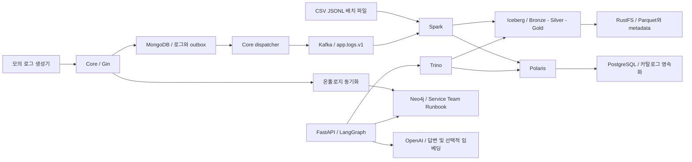

# Operations Log Lakehouse Lab

일반적인 애플리케이션 로그를 수집하고, 장애 징후를 분석하고, 서비스 의존 관계를 따라 조사하는 학습용 서비스입니다. 시작 문서는 [START_HERE.md](START_HERE.md)입니다.

```text
data-pipeline-study/
├── core/             Go + Gin + MongoDB: 서비스 등록, 로그 수집, Kafka 전달
├── data-pipeline/    Python + Spark: 데이터 생성, 배치·스트리밍 적재, 집계, 온톨로지 동기화
├── agent/            FastAPI + LangGraph + OpenAI: 근거 조회와 질의응답
├── frontend/         Next.js + React: 지표, 로그, 서비스 관계, 분석 도우미
├── data/reference/   서비스 정의와 운영 문서
├── data/sample/      재현 가능한 로그 1,000건, CSV·JSONL
├── infra/            Polaris, PostgreSQL, Trino, Spark 설정
├── sql/              분석 SQL
├── examples/         API 요청 예시
├── scripts/          실행 상태 검증
└── docs/             개념, 설계, 실습, 운영 제약
```



`data-pipeline`은 변환뿐 아니라 수집·품질 검사·집계·온톨로지 반영도 담당하므로 `etl`보다 책임을 잘 표현합니다. Iceberg는 독립적인 서버가 아니라 테이블 포맷이며, Polaris가 카탈로그 서버입니다. Spark와 Trino는 같은 테이블을 공유합니다.

Core는 도메인별 Clean Architecture를 적용합니다. 인터페이스는 이를 사용하는 application 계층에 정의하며, domain은 Gin·MongoDB·Kafka를 import하지 않습니다. Python 서비스도 같은 의존 방향을 적용하되 작은 데이터 객체까지 불필요하게 인터페이스로 감싸지는 않습니다.

온톨로지는 Neo4j property graph로 구현합니다. Neo4j의 full-text/vector index를 함께 사용하며, 첫 버전에는 Milvus를 별도로 실행하지 않습니다. 이는 OWL/RDF 추론기가 아니라 Service·Team·Runbook의 타입과 관계를 명시한 운영 도메인 모델입니다.

실행 환경은 Docker Compose이며 Kubernetes는 필요하지 않습니다. Python은 `uv`로 설치합니다. Go가 설치되어 있지 않아도 Docker로 빌드와 테스트를 할 수 있습니다. 전체 스택에는 Docker 메모리 약 8GB 이상의 여유를 권장하며, 파일 생성과 첫 수업에는 Docker가 필요하지 않습니다. 모든 공개 포트는 `127.0.0.1`에 바인딩됩니다.

빠른 실행 순서는 다음과 같습니다. 각 명령의 의미와 예상 결과는 시작 문서에서 설명합니다.

```sh
make setup
make up
make replay
make ingest
make ontology
make evidence
```

`make up`은 상시 서비스를, `make ingest`는 종료되는 Spark 작업을 실행합니다. Spark를 항상 실행할 필요는 없습니다. `make down`은 이번 프로젝트만 중지하고 저장 볼륨을 보존합니다.

대시보드는 [http://localhost:13000](http://localhost:13000)에서 엽니다. 기본 날짜 `2026-10-01`과 Production 환경에 예제 로그가 있습니다. 화면의 새로고침은 저장된 집계를 다시 조회하며 Spark 작업을 실행하지 않습니다. Frontend 구조와 개발·검증 명령은 [frontend/README.md](frontend/README.md)에 설명했습니다.

OpenAI를 연결하려면 `.env.example`을 `.env`로 복사하고 본인의 API 키를 설정한 다음 `docker compose up -d --force-recreate agent`를 실행합니다. `make chat`은 실제 OpenAI API를 호출합니다. `make evidence`는 API 키 없이 동작하며 OpenAI를 호출하지 않습니다. `make embed`는 운영 문서를 유료 임베딩하고, `.env`의 `SEMANTIC_SEARCH=true`는 이후 챗봇 검색에 임베딩을 사용하게 합니다.

설계는 [docs/architecture.md](docs/architecture.md), 단계별 실습은 [docs/labs.md](docs/labs.md), 실행 제약과 문제 해결은 [docs/operations.md](docs/operations.md), 현재 검증 결과는 [docs/verification.md](docs/verification.md)에서 확인합니다.
