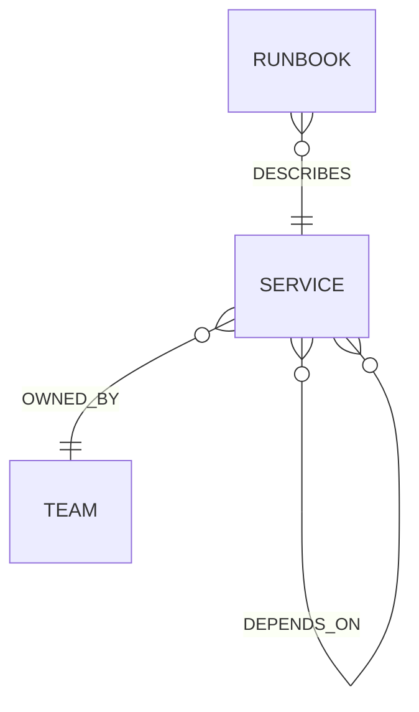

# 패키지 설계와 책임

## Core의 의존 방향

`cmd/api/main.go`는 composition root입니다. 설정을 읽고 MongoDB·Kafka 구현체를 만들어 application에 주입한 다음 Gin 라우터를 연결합니다. infrastructure를 사용하는 코드가 시작점에 모이므로 use case에 환경 설정이나 클라이언트 생성 코드가 섞이지 않습니다.

```text
core/internal/
├── catalog/
│   ├── domain/service.go
│   ├── application/service.go
│   ├── infrastructure/mongodb/repository.go
│   └── presentation/http/handler.go
├── telemetry/
│   ├── domain/event.go
│   ├── application/{ingest,dispatch}.go
│   ├── infrastructure/{mongodb,kafka}/
│   └── presentation/http/handler.go
└── platform/config/
```

domain은 엔티티와 불변 조건을 담당합니다. application은 등록·수집·전달 같은 작업과 이 작업에 필요한 포트를 정의합니다. infrastructure는 포트를 MongoDB와 Kafka로 구현합니다. presentation은 요청과 응답을 변환합니다. catalog와 telemetry는 각각 서비스 등록과 로그 수집이라는 도메인으로 나눴습니다.

Go의 짧은 패키지명과 생성자 주입을 사용합니다. 모든 구조체마다 인터페이스를 만들지 않습니다. 내부 규칙이 사용하는 경계인 Repository·Publisher·ServiceCatalog에만 인터페이스를 정의합니다. import 시 별칭은 다른 도메인에서 같은 이름의 패키지가 겹칠 때 사용합니다. 공유 `utils`, 거대한 `services`, 전역 데이터베이스 클라이언트는 두지 않습니다.

의존 방향은 컴파일 시 import로 결정됩니다. `application`은 다른 도메인의 domain 타입을 사용할 수 있지만 infrastructure를 import하지 않습니다. `domain`은 프레임워크와 저장소를 import하지 않습니다. Go 경계 검사와 Python import-linter 계약은 `make check`에 포함됩니다.

## 데이터 전달을 이해합니다

MongoDB의 로그 문서 하나에 발생 로그와 `published_at`을 함께 저장합니다. 로그 저장과 전달 대기 상태 생성이 같은 insert에 포함되므로 별도의 MongoDB 트랜잭션이 필요하지 않습니다. 이 방식은 embedded outbox 패턴을 학습하기 위한 단일 dispatcher 구현입니다.

Kafka 발행 성공 후 `published_at`을 기록합니다. 이 두 동작 사이의 종료는 중복 발행을 일으킬 수 있습니다. 따라서 전송은 at-least-once이며 전체 파이프라인의 exactly-once를 주장하지 않습니다. Core를 여러 인스턴스로 늘릴 때는 dispatcher lease/claim을 추가해야 합니다.

## Python 패키지를 읽습니다

`data-pipeline/src/observability_pipeline`의 domain은 LogEvent, application은 데이터 생성·재생·온톨로지 동기화·작업 순서, infrastructure는 HTTP·Neo4j·Spark 구현체, presentation은 CLI입니다. Spark API를 사용하는 변환 코드는 infrastructure/spark에 두고 실행 순서는 application/ingestion에 둡니다. `data-pipeline/jobs/lakehouse.py`가 Spark 작업의 composition root입니다.

`agent/src/ops_agent`의 domain은 Inquiry, application은 포트·근거 수집·LangGraph 흐름, infrastructure는 Trino·Neo4j·OpenAI 구현체, presentation은 FastAPI 라우터입니다. `bootstrap.py`가 객체를 조립합니다. LangGraph는 domain에 들어가지 않고 application의 작업 흐름에 들어갑니다.

Agent의 그래프는 `collect_evidence → answer`입니다. 첫 노드는 고정 SQL과 고정 Cypher를 실행해 근거를 모으고, 다음 노드는 실제 OpenAI Responses API로 설명을 만듭니다. 첫 버전은 요청마다 독립적으로 실행됩니다. 대화 이력, 자율적인 SQL 생성, 예약 작업과 서버 변경 기능은 포함하지 않습니다.

## 온톨로지 모델



Service는 id와 name, Team은 name, Runbook은 id·title·content를 가집니다. `DEPENDS_ON`은 호출하는 서비스에서 호출받는 서비스로 향합니다. checkout → payment라는 관계가 있으면 payment의 장애가 checkout에 영향을 줄 가능성을 조사할 수 있습니다. 이 관계만으로 원인을 확정하지는 않습니다.

Core의 서비스 카탈로그가 서비스 정의의 원본입니다. `make ontology`는 그 API를 읽어 Neo4j에 멱등적으로 반영합니다. 관계 목록을 교체하고 문서 내용이 바뀌면 기존 임베딩을 제거합니다. 서비스와 문서를 삭제하는 API는 아직 없으며 동기화도 원본에서 사라진 노드 전체를 삭제하지 않습니다.

Neo4j에는 full-text index와 1536차원 cosine vector index를 만듭니다. 기본 검색은 full-text이며 결과가 없으면 해당 서비스에 연결된 운영 문서를 반환합니다. 선택적 벡터 검색은 실제 OpenAI 임베딩을 사용합니다. 두 검색 점수를 섞어 동일한 척도라고 취급하지 않습니다. 운영 문서는 사전에 작성한 점검 절차이며 로그에서 자동 추출한 인과 지식은 아닙니다.

## 테이블 계약

| 테이블 | 키와 의미 | 처리 규칙 |
|---|---|---|
| bronze.logs | source_key, 원문 payload, 수집 정보 | 파일은 payload 해시, Kafka는 topic/partition/offset으로 재처리를 구분합니다. |
| silver.logs | event_id, 검증된 발생 로그 | 동일 event_id는 최초 유효 레코드를 유지합니다. |
| silver.quarantine | source_key, 원문, 오류 사유 | 형식·범위·필수 값 검증에 실패한 로그를 보존합니다. |
| gold.service_hourly | service_id/environment/hour | 요청 수, HTTP 5xx 수, 오류율, 평균 및 p95 지연을 저장합니다. |

Bronze·Silver·Gold는 각각 별도 Iceberg 테이블입니다. 테이블 간 원자적 트랜잭션은 없습니다. 중간 실패 후 다시 실행하면 MERGE로 진행하며, Gold는 Silver 전체를 다시 집계해 늦게 도착한 로그도 반영합니다. 대규모 운영에서는 영향을 받은 시간대만 다시 계산하도록 변경할 수 있습니다.

## Frontend 조회 경로

Next.js는 페이지와 브라우저 전용 상태를 담당하고, Route Handler를 BFF로 사용합니다. 브라우저는 같은 origin의 고정된 `/api/*` 경로만 호출합니다. Core·Agent 주소와 OpenAI 키를 브라우저에 전달하지 않습니다.

```text
브라우저 / Next.js 화면
  → Next.js /api/events → Core ReadEvents → MongoDB
  → Next.js /api/metrics → Agent ReadDashboard → Trino → Iceberg Gold
  → Next.js /api/evidence → Agent CollectEvidence → Trino + Neo4j
  → Next.js /api/chat → Agent LangGraph → 근거 수집 → OpenAI 답변
```

Core에서 `EventReader`와 `ReadEvents`를 추가해 수집·outbox 포트와 조회 포트를 분리했습니다. application 계층에서 필터와 페이지 크기를 검증하고, infrastructure 계층에서 MongoDB 쿼리를 구성합니다. 검색어는 정규식 기호를 이스케이프한 부분 문자열로 처리하며 조회 날짜는 UTC 하루 범위로 제한합니다.

Frontend는 `features/observability`, `logs`, `topology`, `assistant`로 도메인을 나눴습니다. 순수 집계 계산은 `domain`에, 서버 전용 HTTP 어댑터는 `shared/infrastructure`에 둡니다. 가중 평균과 오류율 계산은 요청 수를 기준으로 수행하며, 시간별 p95를 평균 내서 전체 p95로 표현하지 않습니다. 실시간 로그와 마지막 집계 결과가 다를 수 있음을 화면에 표시합니다.
